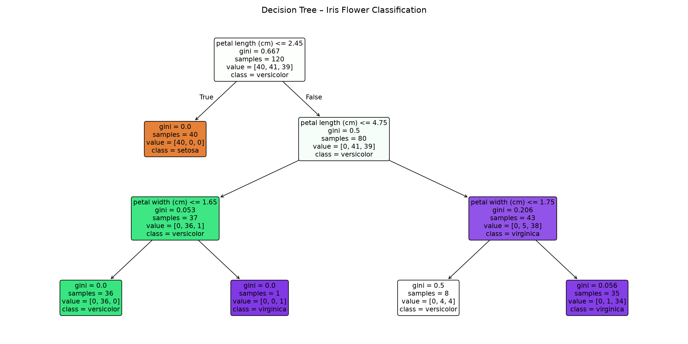

# DecodeLabs AI Industrial Training – Project 02
## Data Classification Using AI

A beginner-friendly machine learning project that classifies Iris flowers into three species using a **Decision Tree Classifier**.

---

## Project Structure

```
DecodeLabs-Data-Classification/
├── main.py            # Main script – all project logic lives here
├── requirements.txt   # Python dependencies
├── README.md          # This file
└── decision_tree.png  # Generated automatically when you run main.py
```

---

## What This Project Does

| Step | What happens |
|------|-------------|
| 1 | Loads the Iris dataset and displays the first few rows |
| 2 | Shows dataset info, feature names, target labels, and statistics |
| 3 | Splits data into **80% training** and **20% testing** sets |
| 4 | Trains a **Decision Tree Classifier** on the training data |
| 5 | Makes predictions on the test set |
| 6 | Displays **accuracy score** and **classification report** |
| 7 | Shows actual vs predicted results side-by-side |
| 8 | Predicts the species of **3 new flower samples** |
| 9 | Saves a visual diagram of the decision tree as `decision_tree.png` |

---

## Requirements

- Python 3.8 or higher
- pip (Python package manager)

---

## Setup & Installation

### Step 1 – Open a terminal in the project folder

```bash
cd path/to/DecodeLabs-Data-Classification
```

### Step 2 – (Optional but recommended) Create a virtual environment

```bash
# Create
python -m venv venv

# Activate on Windows
venv\Scripts\activate

# Activate on macOS / Linux
source venv/bin/activate
```

### Step 3 – Install dependencies

```bash
pip install -r requirements.txt
```

---

## Running the Project

```bash
python main.py
```

That's it. No extra arguments needed.

---

## Expected Output

```
============================================================
  DECODELABS PROJECT 02 – DATA CLASSIFICATION USING AI
============================================================

📋 FIRST 5 ROWS OF THE DATASET
...

📐 DATASET SHAPE: 150 rows × 6 columns

🔑 FEATURES (Input Variables):
   1. sepal length (cm)
   2. sepal width (cm)
   3. petal length (cm)
   4. petal width (cm)

🌸 TARGET LABELS (Classes to Predict):
   0 → setosa       (50 samples)
   1 → versicolor   (50 samples)
   2 → virginica    (50 samples)

📊 BASIC STATISTICS ...

============================================================
  SECTION 2: TRAIN / TEST SPLIT
============================================================
  Total samples  : 150
  Training set   : 120 samples  (80%)
  Testing set    : 30  samples  (20%)

============================================================
  SECTION 3: MODEL TRAINING & EVALUATION
============================================================
✅ Decision Tree model trained successfully.
🎯 MODEL ACCURACY: 100.00%

📋 CLASSIFICATION REPORT ...

🔍 ACTUAL vs PREDICTED (first 20 test samples) ...

============================================================
  BONUS: PREDICT A NEW FLOWER SAMPLE
============================================================
  [5.1, 3.5, 1.4, 0.2]  →  setosa        (confidence: 100.0%)
  [6.7, 3.1, 4.7, 1.5]  →  versicolor    (confidence: 100.0%)
  [6.3, 3.3, 6.0, 2.5]  →  virginica     (confidence: 100.0%)

🌳 Decision Tree diagram saved as 'decision_tree.png'

============================================================
  PROJECT COMPLETE – All requirements satisfied.
============================================================
```

---

## Mandatory Requirements Coverage

| Requirement | Covered in |
|-------------|-----------|
| 1. Load and understand the dataset | `load_and_explore_dataset()` |
| 2. Split data into training and testing sets | `split_dataset()` |
| 3. Apply a Decision Tree Classifier | `train_and_evaluate()` |

---

## About the Dataset

The **Iris dataset** is one of the most well-known datasets in machine learning.

- **150 samples** of iris flowers
- **4 features**: sepal length, sepal width, petal length, petal width (all in cm)
- **3 classes**: *Iris setosa*, *Iris versicolor*, *Iris virginica*
- **50 samples** per class (perfectly balanced)

---

## Decision Tree Visualisation

The diagram below is generated automatically when you run `main.py`.  
Each node shows the splitting condition, Gini impurity, sample count, and predicted class.



---

## About the Algorithm

A **Decision Tree** works by asking a series of yes/no questions about the input features. Each question splits the data further until a final class label is predicted. It is intuitive, fast, and easy to visualise — making it a great first classification algorithm to learn.

---

*DecodeLabs AI Industrial Training | Project 02*
